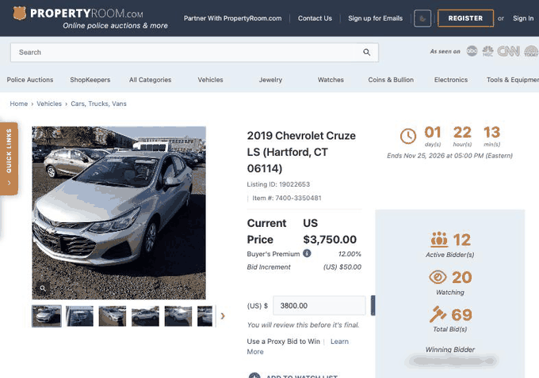

# Police Auction Bidding Agent — built on Muse Ember

**Built with Muse on iPhone** — designed, coded, tested, and demoed from the Muse iPhone app.

An agent that bids on PropertyRoom police auctions without ever bidding
blind. It evaluates a lot, reads the buyer's premium, tax, and shipping
off the lot's own page, sets an all-in max it will not exceed, and bids
only when the math clears. Every evaluation runs on **Muse Ember** — and
the $10 hackathon budget is the product, not a limit on it: cheap Ember
evaluations are exactly what this agent does all day.

Built for the **Muse Ember Hackathon** (Cerebral Valley / Meta). Application
approved Mon Nov 23, 2026. Build window Nov 23 – Dec 2, 2026, 9:00 PM ET.
Solo, virtual, US-only. $5,000 in prizes.

## The idea



*A live lot page on PropertyRoom.com, recorded Nov 23, 2026. This page is all the agent reads. The line naming the high bidder is blurred.*

PropertyRoom.com auctions seized, found and surplus goods on behalf of police
departments and other public agencies. It sells them as-is, and its fees are
a trap for anyone who bids on the hammer price alone:

- **The buyer's premium varies per lot.** PropertyRoom's help says it is
  "not a charge that is on most items", and that a lot with a 10%, 12% or
  15% premium has it "stated in the auction table". Third-party guides
  claim a 16.5% standard. The agent never hardcodes a rate. It reads the
  premium off each lot's own page: a stated rate is used, a page that never
  mentions a premium has none, and a page that mentions one without a
  readable rate is held for a human.
- **The soft reserve.** On a reserve auction the seller has one business
  day after close to accept the high bid even if the reserve was never met —
  and acceptance commits you and auto-charges you. Reserve lots are held
  for a human by default.
- **The payment method on file is auto-charged at close.** So the agent's
  all-in math is the safety: hammer + premium + tax + shipping, capped by
  a max it will not cross.

This is the same spending-policy-agent lineage as the author's AI
Infrastructure SimCity (PayPal sandbox): a policy gate evaluates every
spend before anything is created, with a per-transaction cap, a session
budget, and an auto-approve threshold — here the cap is PropertyRoom's own
$4,999.99 card/PayPal ceiling, and the agent never wires money.

## How it works

```
lot URL + all-in max
  -> fetch the lot's own PropertyRoom page (public, no login)
  -> deterministic parse: price, premium, increment, reserve, status, shipping
  -> Muse Ember (muse-ember-1.0) reads the same page on its own and returns
     structured JSON: the same fields, a value estimate, and a stance on
     the listing
  -> deterministic math: all-in = hammer + premium + tax + shipping
     max hammer = the largest whole-cent bid whose all-in stays inside the max
  -> verdict: BID / NO_BID / HOLD_FOR_HUMAN
  -> bid plan: the proxy maximum to set, inside every limit
  -> spending policy gate (SimCity pattern): cap, session budget, mode
  -> dry-run (default): prints the exact bid it would place. No money moves.
```

The money numbers always come from the deterministic parse. Ember is the
second pair of eyes, and its read can only make the agent more careful:

- **Two reads must agree.** Ember extracts the price, premium, increment,
  reserve flag, status and shipping prices independently. If any of them
  differs from the parse, one of the two misread the page, and the lot is
  held for a human.
- **Ember can veto.** Its stance covers what the numbers cannot see. For a
  vehicle: does it start and run, is there a key and a clean title, is the
  mileage credible. For anything else: is it for parts, is something it
  needs missing (a charger, a battery), is it a vague mixed lot. Anything
  other than "bid" turns a clearing bid into HOLD_FOR_HUMAN, with Ember's
  reasoning in the verdict.
- **Ember prices the item.** It estimates what the item would fairly sell
  for second-hand and says what it compared it to. If the all-in total is
  above the top of that range, the lot is held.

A "bid" stance never forces a bid. Ember cannot move a NO_BID or a hold
toward spending, so a lot page that tries to talk the model into something
gains nothing.

One Ember call per lot evaluation. The model is sent the lot itself (title,
fee table, description, shipping table), not the site navigation around it.

### The bid plan

PropertyRoom takes proxy bids: you set a maximum and it bids the lowest
amount needed to lead, never more. It also extends an auction that gets a
bid in its last minute, so bidding late gains nothing. The right move is one
disciplined maximum, set once.

When the verdict is BID the agent works out that maximum: the highest
whole-dollar hammer price whose all-in total stays inside all three limits.

- your all-in max
- the top of Ember's value estimate
- what the spending policy has left (the $4,999.99 cap, or the rest of the
  session budget)

The plan says which limit set the ceiling, and the policy gate judges the
most the bid can cost, not just the next increment.

One exception. When the reserve is not met, PropertyRoom bids a proxy's
full maximum at once. On a reserve lot you have allowed, the agent places a
plain bid at the next increment instead.

### No max? It suggests one

Run a lot without an all-in max and the agent does not bid. It reports
Ember's value range, suggests the low end as a max, and shows the hammer
price that max would allow. Only a max you give can lead to a bid, so a
generous estimate can never spend money on its own.

### Watching

`watch.py` re-reads a list of lots on an interval until they end. A lot is
only sent to Ember again when its price, status or fees changed, so a quiet
auction costs nothing to watch. It prints the full verdict on the first look
and whenever the verdict changes, and one line for a price move that changes
nothing. It never bids.

**Three things the lot page does not tell you, handled honestly:**

1. **Tax is not printed on a lot page.** It is computed at checkout from
   the ship-to state. The agent treats tax as a *configured assumption*
   (`tax_rate`, e.g. 0.10 for the demo) and labels it as such in every
   verdict. With no rate configured, the agent holds every lot for a human.
2. **Pickup is not free.** Customer Pick-up is often the only way to get a
   vehicle, and the page prices it at $0.00 to $23.95, but someone still
   has to travel to the lot or pay to haul it. The agent never chooses
   pickup unless you tell it what collecting costs you (`pickup_cost_usd`,
   0 if you are local). That amount is added to the page's pickup fee.
   A pickup-only lot with no pickup cost configured is held for a human.
3. **Whether the auction is still running.** Every page, live or ended,
   carries the words "Ending" and "Ended" in its countdown. The agent only
   treats a lot as live when the page prints an "Ends <date>" line. If it
   cannot tell, it holds.

## The $10 budget math

Muse Ember on the Meta Model API (verified Nov 23, 2026):
`muse-ember-1.0`, `https://api.meta.ai/v1`, OpenAI-compatible.
$0.10 / 1M input tokens, $0.004 / 1M cached, $0.50 / 1M output
(prompts up to 200K tokens; above that the whole request triples).

One lot evaluation, measured on the live runs of Nov 23, 2026 (26
evaluations of seven real lots):

| | tokens | cost |
|---|---|---|
| input (instructions + the lot's page text) | 2,355 to 5,808 | $0.00024 to $0.00058 |
| output (Ember's thinking + its JSON reply) | 573 to 1,035 | $0.00029 to $0.00052 |
| **per evaluation** | | **$0.0004 to $0.00096, average $0.0008** |

**$10 buys roughly 12,500 evaluations.** A full auction watch — say 200
lots a day for the 10-day build window — is about $1.60 even if every lot
changed on every check, and less in practice because unchanged lots are
not re-sent.

Muse Ember is a reasoning model: its thinking is billed as output and
counts against the output cap. The client asks for `reasoning_effort: low`
and caps output at 4,000 tokens, which leaves room for the thinking and the
answer and keeps the worst case for one call under $0.003. (At a 1,200-token
cap the model spent the whole allowance thinking and returned no answer.)

The budget is a wall in front of the call, not a note after it. Before each
request the client prices the worst case (the whole prompt plus the full
output cap) and refuses to send anything that could push spend over $10.
After the call, what it really cost is always written to
`cost_ledger.jsonl` with tokens and the running total.

Ledger after the command-line runs below: 40 calls, 34 of them live,
**$0.0251 spent, $9.97 left**. That total includes four early calls that
came back empty because of the 1,200-token cap, and four tiny calls that
checked which settings the API accepts. The UI's Ledger page shows the
running total, including runs made from the UI since.

## Demo results

Run Nov 23, 2026 on live Muse Ember, against real lot pages fetched at run
time. Assumptions: 10% tax, $0 pickup cost (a local buyer).

`python3 run_demo.py --live-ember` evaluates four real lots. The three that
have ended are each run twice: as listed, and "as-if-live" (the "Ended" line
rewritten to "Ends", fee data untouched) so the paths past "auction ended"
are exercised.

| Lot | Premium (read) | Next bid -> all-in | As listed | As-if-live | What Ember saw |
|---|---|---|---|---|---|
| 2019 Ford F-150, ended $10,850, max $13,500 | 12% | $10,900 -> $13,428.80 | NO_BID (ended) | **HOLD_FOR_HUMAN** — math clears, Ember objects | Does not start or run, odometer not credible. Worth $7,000 to $11,000 |
| 2014 Chevrolet Caprice, ended $4,450, max $6,000 | 15% | $4,500 -> $5,716.45 | NO_BID (ended) | **HOLD_FOR_HUMAN** — reserve not met (soft-reserve trap) | Starts and runs, key, regular title: stance "bid". Worth $5,000 to $8,000 |
| 2007 Toyota Prius, ended $800, max $1,500 | 15% | $850 -> $1,099.20 | NO_BID (ended) | **HOLD_FOR_HUMAN** — math clears, Ember objects | Salvage title; start/run, key and mileage all unknown. Worth $400 to $1,200 |
| Dell Latitude 7220 tablet, live at $181, max $400 | none | $184 -> $214.35 | **HOLD_FOR_HUMAN** — math clears, Ember objects | (still live) | Powers on, but no power adapter and no Windows key. Worth $200 to $350 |

A vehicle that was really live at the time, through `evaluate.py` with a
$5,000 max:

| Session budget | Verdict | Bid plan | Policy gate |
|---|---|---|---|
| $2,000 (default) | **BID** — next bid $3,800 lands all-in at $4,681.60; both reads agree; Ember's stance is "bid" (starts and runs, key, regular title; worth $4,500 to $6,500) | No room for a proxy: the next bid is already over what the policy has left | **DENIED** — over the session budget |
| $5,000 (set in `config.json`) | **BID**, same reasons | **Proxy bid, maximum $4,058**; bids $3,800 now; all-in at most $4,999.46, the ceiling set by the $4,999.99 card cap | **DRY_RUN** — prints the bid request and stops |

Everyday lots, which print no buyer's premium:

| Lot | Run | Result |
|---|---|---|
| Sealed DVD box set, live at $1.99, max $40 | `watch.py` | Stance "bid", next bid lands all-in at $23.48 (shipping is $17.99 of it), but Ember values it at $5 to $12: **HOLD_FOR_HUMAN**, all-in above the top value estimate |
| Skullcandy headphones, live at $19, no max | `evaluate.py` | **No bid without a max.** Ember values them at $25 to $50 and suggests a $25 max, which the next bid's $41.15 all-in is already past |

`watch.py` ran over three live lots for two rounds: three evaluations on the
first round, none on the second because nothing had moved.

In all 26 evaluations Ember's own read of the page matched the parser on
every money field. Its value estimates move a little from run to run.

The Prius is the case for the second read. On the numbers alone it is a
clean bid at $1,099.20 all-in, and with no model in the loop
(`python3 run_demo.py`, fixture mode) the agent prints a bid for it.
The listing's own text says salvage title, key unknown, running condition
unknown.

No bids were placed. No money moved.

## The demo UI

```bash
python3 ui.py          # then open http://127.0.0.1:8765
```

A small dark, multi-page web app over the same agent, for showing it to
people. Python's own web server and one stylesheet and script; nothing to
install.

| Page | What it shows |
|---|---|
| Overview | What the agent does, the three traps, and where things stand |
| Demo | An auction that is live right now, then the four demo lots. For each: the listing on PropertyRoom, the command-line run, and the UI run |
| Lots | Paste a lot link and an all-in max; read the verdict, the bid plan and Ember's reasoning |
| Policy | The spending gate in order, and your tax, pickup and delivery assumptions |
| Ledger | Every model call with its tokens and cost, against the $10 |
| Method | How a verdict is made, when the agent holds, and what is not built |
| Command line | The section below, so the no-UI usage travels with the demo |

The Demo page shows one lot three ways. First the listing, as the lot's
own page reads at that moment, with a button that opens the real page
(PropertyRoom does not allow its pages to be shown inside other sites, so
the UI shows the listing's text, not a frame). Then the command line: the
exact `run_demo.py` command for that lot and what it prints for the same
run. Then the UI's own verdict cards. Each run starts by picking an auction
that is live on PropertyRoom's vehicles listing, preferring one that prints
a buyer's premium, and gives it an all-in max a quarter above what the next
bid costs.

Run this way it is a local tool. It listens on `127.0.0.1` only, accepts
changes only from its own pages, will only fetch PropertyRoom lot pages, and
is dry-run only: nothing in it can place a bid. Your API key stays in the
server process; the pages are only told whether a live model is in use.

With a key in `.env` it uses live Muse Ember, at about $0.0008 for each new
lot or lot whose price or fees changed. Changing your max or your
assumptions, or re-running the demo, re-works verdicts without another call.
`python3 ui.py --fixture` never calls the model. Your lots are kept in
`watchlist.json`, the same file `watch.py` reads.

### On Vercel

The same UI deploys to Vercel as one Python function plus the `public/`
folder; [DEPLOY.md](DEPLOY.md) has the steps. Hosted, the server keeps
nothing between requests, so each visitor's lots and assumptions live in
their own browser, and the ledger is per server instance. Anyone with the
link can spend the key you give it, so read the notes there first.
`python3 ui.py --hosted` runs that mode locally.

## Run it from the command line

```bash
# Demo: four real lots, end to end, evaluation only (fixture mode, $0)
python3 run_demo.py

# Same demo on the real model
python3 run_demo.py --live-ember

# Also run an auction that is live on PropertyRoom right now
python3 run_demo.py --live-lot

# One lot of your own (dry-run; prints the bid it would place)
python3 evaluate.py --lot https://www.propertyroom.com/l/.../12345678 \
  --max 1500 --tax-rate 0.10 --pickup-cost 0

# No max: get a suggested max from Ember's value estimate, no bid
python3 evaluate.py --lot https://www.propertyroom.com/l/.../12345678 --tax-rate 0.10

# Watch lots until they end (copy watchlist.example.json to watchlist.json)
python3 watch.py --watchlist watchlist.json --interval 300

# Tests (167, no network, no API key)
python3 -m unittest discover -s tests
```

Python 3.10+, standard library only — no `pip install` needed.

### Settings

Copy `config.example.json` to `config.json` to set your tax rate, pickup
cost, shipping preference, default all-in max and policy limits once.
`evaluate.py`, `watch.py` and `ui.py` read it, and any flag on the command
line wins over it. `config.json` and `watchlist.json` are git-ignored.

### Live Muse Ember

Copy `.env.example` to `.env` and put your key in `MODEL_API_KEY`. The
scripts read `.env` on their own; a variable already set in your shell wins
over the file. `.env` is git-ignored.

`evaluate.py`, `watch.py` and `ui.py` use the real model whenever a key is
present. `run_demo.py` only does when you pass `--live-ember`, so the plain
demo never spends.

**Without a key the agent runs in fixture mode** (the SimCity pattern): a
deterministic local evaluator returns the same JSON schema Ember would,
marked `simulated`, at $0.00. Nothing is sent to a model, and the ledger
says so in plain words. In fixture mode the "second read" is the parser
itself, so it always agrees and gives no value estimate.

## Safety: the agent cannot spend money on its own

- **Dry-run is the default.** The agent prints the exact bid it would
  place and stops. A bid needs `--live --confirm` on the command line.
- **No max, no bid.** Only an all-in max you give can lead to a bid. A
  value estimate can lower a bid's ceiling, never raise it past your max.
- **When unsure, it holds.** Unknown auction status, an unreadable premium,
  no tax rate, no usable delivery method, a soft reserve, two reads that
  disagree, or an objection from Ember all end in HOLD_FOR_HUMAN.
- **Policy gate, in order:** a NO_BID/HOLD verdict never spends; an
  all-in over the $4,999.99 transaction cap is denied outright (at $5,000+
  only a wire works, and the agent never wires money); committed exposure
  plus the new all-in may not exceed the session budget ($2,000 default).
  A proxy bid is judged at its maximum.
- **Live bidding is not configured.** `live_bid.py` refuses every live
  attempt until an account is configured, and the bid-placement transport
  itself is intentionally not wired up (it needs an authenticated session
  for a real registered account). Nothing in this codebase can charge a card.

## Files

| Path | What it is |
|---|---|
| `run_demo.py` | Demo: 4 real lots, as-listed + as-if-live, ledger summary |
| `evaluate.py` | CLI: evaluate one lot (`--lot URL [--max N] [--tax-rate R] [--pickup-cost C]`) |
| `watch.py` | CLI: watch lots until they end (`--watchlist FILE` or `--lot URL --max N`) |
| `ui.py` | The demo UI's server (`--port N`, `--fixture`, `--hosted`) |
| `api/index.py` / `vercel.json` | The Vercel entry point and its config; see `DEPLOY.md` |
| `src/agent.py` | Orchestration: fetch -> Ember -> math -> policy gate |
| `src/ember_client.py` | Muse Ember client (OpenAI-compatible), pricing, pre-call budget check, fixture mode |
| `src/cost_ledger.py` | JSONL ledger of every model call + $10 budget wall |
| `src/lot_fetcher.py` | Fetch + parse a lot page (premium read, never hardcoded) |
| `src/evaluator.py` | All-in math, max hammer, the two-read check, verdicts, the bid plan |
| `src/policy.py` | Spending policy gate (SimCity pattern, adapted) |
| `src/live_bid.py` | Gated live-bid path — refuses without config + confirm |
| `src/watcher.py` | The watch loop: re-evaluates a lot only when it changed |
| `src/demo.py` | The demo run and its assumptions, finding a live auction, and what the command line prints; shared by `run_demo.py` and the UI |
| `src/web.py` / `src/mini_markdown.py` | The UI's routes and JSON API; renders this README's command-line section into the UI |
| `web/` / `public/` | The UI: one shell and a fragment per page in `web/`; the stylesheet, the script and the recording of a PropertyRoom lot page in `public/` |
| `src/config.py` / `src/cli.py` | Loads `.env` and `config.json`; flags shared by the scripts |
| `src/demo_lots.py` | The four demo lots |
| `tests/` + `tests/fixtures/` | 167 unit tests; fixtures mirror the layout of real lot pages |
| `config.example.json` / `watchlist.example.json` / `.env.example` | Templates (copy, never commit secrets) |
| `cost_ledger.jsonl` | Ledger from the demo runs |

## Not built yet

- **Placing a bid.** The agent stops at the exact bid request. The
  transport needs a registered PropertyRoom account with a payment method
  on file, and a person reviewing the first requests.
- **Acting from a watch.** `watch.py` reports; it does not place or raise
  bids, and it keeps nothing between runs.
- **Market data.** The value estimate is Ember's judgment from the listing
  text alone. It is not checked against sold prices, and Ember cannot see
  the photos.
- **Opening bids.** The next bid is always read as current price plus one
  increment, which is one increment high on a lot with no bids yet. A proxy
  bid is not affected.
